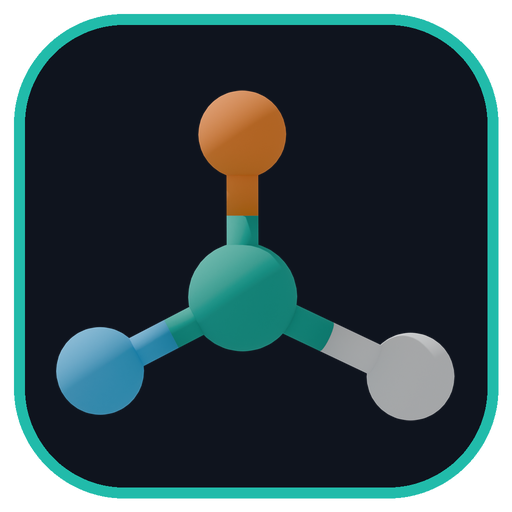
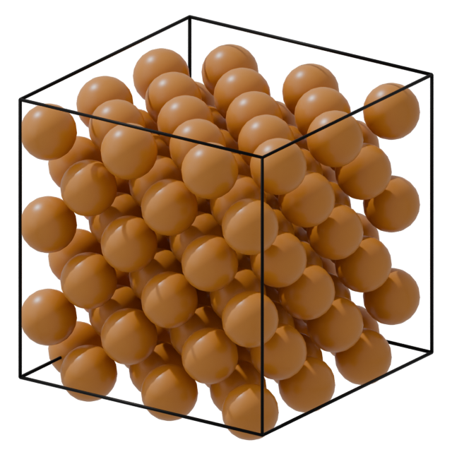
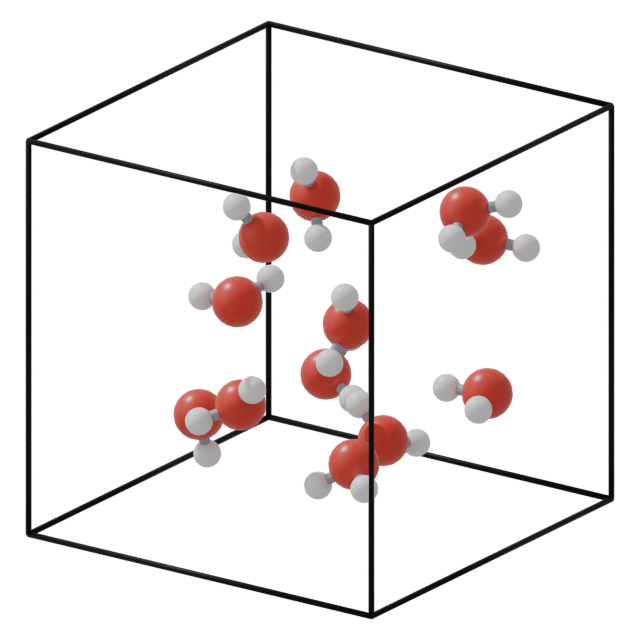
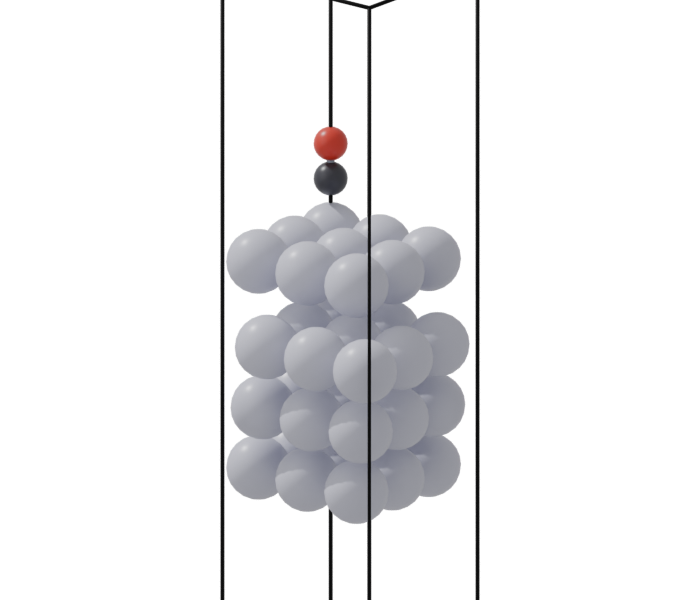
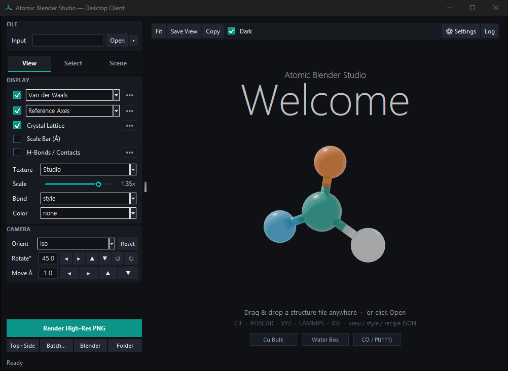

<p align="center">
  
</p>

<h1 align="center">Atomic Blender Studio</h1>

<p align="center">
  Reusable publication-quality atomic structure renderer combining <strong>ASE</strong> (universal structure parsing, supercell replication, periodic wrapping) with <strong>Blender Cycles</strong> (consistent materials, orthographic framing, GPU/OptiX acceleration, a standalone desktop studio GUI, and a Blender N-panel addon).
</p>

<p align="center">
  
  
  
</p>

## Features

- **Style-driven rendering (`styles/default.json`)**: Separates element colors (with Jmol/CPK fallback for all elements), radii, Principled BSDF parameters (`Roughness = 0.35`, `Specular = 0.4`), bond cutoffs, 12-edge triclinic cell wireframe, Sun + Area fill lighting, and Cycles GPU/CPU settings into JSON.
- **Universal input via ASE -> neutral JSON**: Supports `POSCAR`/`VASP`, `.cif`, `.xyz`/`.extxyz`, LAMMPS `.data` (with `--type-map`), and any ASE-readable format without requiring ASE inside Blender's embedded Python.
- **Supercells & triclinic cells**: Supports `--replicate NX NY NZ`, periodic wrapping, general 3D triclinic cell edges, and `--crop-z auto` for slabs with large vacuum layers.
- **Headless CLI & interactive GUI workflow**: Frame structures interactively in Blender's 3D Viewport, snap the camera with **Camera to Current View**, export `view.json` with **Save View**, and reproduce the exact framing headlessly via `--view view.json`.

---

## Requirements

- **Python** `>= 3.10` with [ASE](https://wiki.fysik.dtu.dk/ase/) (`ase >= 3.22`) and `numpy`
- **Blender** `4.x` or `5.x` (tested on Blender 5.2.3 LTS with Cycles OptiX)

## Installation

Install directly from GitHub (for private access, ensure your Git credentials or SSH key are configured):

```bash
pip install git+https://github.com/polar2251/atomic-blender-studio.git
```

Or clone and install locally (standard or editable mode):

```bash
git clone https://github.com/polar2251/atomic-blender-studio.git
cd atomic-blender-studio
pip install .          # standard self-contained install
# or: pip install -e . # editable development install
```

Blender is auto-detected across **Windows** (`Program Files\Blender Foundation\Blender*` and `%LOCALAPPDATA%`), **macOS** (`/Applications/Blender.app`), **Linux** (`/usr/bin/blender`, `/usr/local/bin/blender`, `/snap/bin/blender`, `/opt/blender*`), and `PATH`. If Blender is installed in a custom location, pass `--blender <path-to-blender>` or set `BLENDER_EXE`:

```powershell
$env:BLENDER_EXE = "C:\Program Files\Blender Foundation\Blender 5.2\blender.exe"
```

### Installing the Blender GUI Addon

Install and enable the N-panel addon directly into Blender's user addons directory:

```bash
atomic-blender install-addon
```

To export a standalone `.zip` archive for manual installation via Blender's **Edit > Preferences > Add-ons > Install from Disk**:

```bash
atomic-blender install-addon --zip atomic_blender_studio.zip
```

> **Note on Blender built-in addon naming**: Blender ships with a built-in `"Atomic Blender (PDB/XYZ)"` addon (`io_mesh_atomic`). To avoid any module, UI, or operator collision, this project registers under the distinct module name **`atomic_blender_studio`**, display name **`Atomic Blender Studio (Publication Renderer)`**, N-panel tab **`Atomic Studio`**, and operator namespace **`atomic_studio.*`**. Both addons can coexist safely.

---

## Desktop GUI Client (`atomic-blender gui`)

Launch the standalone desktop window (built on Python's standard `tkinter`, or build a self-contained Windows app with `atomic-blender install-desktop --build-exe`):

```bash
atomic-blender gui
# or directly:
atomic-blender-gui [optional_structure_file]
```

<p align="center">
  
</p>

Inside the desktop client (styled in a modern dark studio UI) you can:
- **Display Styles & Overlays**: Toggle **Ball and Stick**, **Licorice**, **Van der Waals**, **Crystal Lattice**, **Atom Labels**, and **Reference Axes** (`x, y, z` axis triad with **x, y, z Labels** toggle and **Fix (Default)** reset; click and drag the axes gizmo directly on the viewport to reposition it anywhere).
- **Drag & drop** structure files (`POSCAR`, `.cif`, `.xyz`, `.data`, `.json`), `view.json`, or custom `style.json` files directly onto the window (or click **Browse...**), triggering an instant **fast low-resolution Blender Cycles preview** alongside the live structure inspector banner (formula, atom count, lattice parameters, PBC) and one-click **Smart Slab Preset** / **Cube / Bulk Preset**.
- **Hybrid 3D Drag + Auto Blender Preview**: Rotate (`left-drag`), pan (`right-drag` or `Shift + left-drag`), and zoom (`scroll`) smoothly in the real-time 3D viewport (showing shaded spheres, thicker bonds, subtle outlines on Hydrogen atoms, and a **Dark Backdrop** toggle), then automatically re-render a fast Cycles preview of that exact camera view as soon as interaction pauses. Click **Save view.json...** to export the exact camera state or **Reset / Fit View** to re-frame.
- Choose a style (`studio`, `matte`, `ball_and_stick`, `default`, or a custom `.json`), tune **Atom Scale** (`0.4`–`1.6`), toggle **Show Cell**, set **Bond Color** (`bicolor` or `single`), switch view presets (`Iso`, `Side`, `a`, `b`, `c`) or a saved `view.json` (`--fit-view`), and configure supercell replication, `wrap`, `--crop-z`, resolution, and Cycles samples.
- Click **Render High-Res Output** to raytrace the exact current camera angle and zoom at your full target resolution and Cycles sample count to the output PNG.
- Click **Open in Blender** to generate a `.blend` scene with the active settings and launch the Blender GUI.

---

## Headless CLI Usage

### Render a structure

If you installed via `pip install git+...` in an empty working directory, generate or download a sample `.cif` first:

```bash
# Quick sample CIF in any empty directory (or download from GitHub examples/)
python -c "from ase.build import bulk; import ase.io; ase.io.write('fcc_cu_bulk.cif', bulk('Cu', 'fcc', a=3.615, cubic=True).repeat((3, 3, 3)))"

# Default isometric view (azimuth 35°, elevation 20°)
atomic-blender render fcc_cu_bulk.cif --style default --view iso --out cu.png

# Slab with large vacuum: side-oblique preset + automatic Z-range cropping
atomic-blender render examples/co_on_pt111.vasp --style default --view side-oblique --crop-z auto --resolution 1400 1200 --out slab.png

# Supercell replication + saving an editable .blend file
atomic-blender render examples/water_box.xyz --replicate 2 2 1 --view iso --out water_221.png --save-blend water_221.blend

# LAMMPS data file with explicit type mapping
atomic-blender render structure.data --type-map "1:Al,2:C,3:H" --view side-oblique --crop-z auto --out slab.png
```

### Before / After Relaxation Comparison (CO on Pt(111))

1. Launch the desktop app: `atomic-blender-gui examples/03_relax_final_CO_Pt111.vasp` (or drag & drop the file).
2. Open the **Scene** tab → **COMPARE (GHOST OVERLAY)** and click **Load Reference...** to select `examples/03_relax_initial_CO_Pt111.vasp` (or **Pin Current** before switching trajectory frames).
3. Switch between **Overlay** (translucent ghost reference + dashed displacement vectors) and **Side-by-Side** (synchronized dual camera), double-click an adsorbate atom (`C` or `O`) to read its displacement magnitude `Δr`, and click **Render High-Res PNG**.

### View presets

| Preset | Description |
|---|---|
| `iso` | Azimuth `35°`, elevation `20°` |
| `side-oblique` | Azimuth `25°`, elevation `10°` |
| `a` | View along lattice vector `a` |
| `b` | View along lattice vector `b` |
| `c` | View along lattice vector `c` |
| `<path/to/view.json>` | Exact camera transform, `ortho_scale`, and resolution saved from GUI |

### Additional CLI options

- `--bonds table|auto|none`: Override bond drawing mode (`table` uses style cutoffs; `auto` uses covalent radii; `none` disables bonds).
- `--bond-color style|single|bicolor`: Override bond coloring (`bicolor` splits each bond into two half-cylinders matching endpoint atom colors).
- `--radius-scale FLOAT`: Scale atomic sphere radii continuously (e.g., `0.78` for compact ball-and-stick).
- `--no-cell`: Hide the 12-edge periodic cell wireframe box.
- `--fit-view`: Keep the camera orientation from `view.json` while re-fitting `target` and `ortho_scale` to a new or replicated structure.
- `--samples N`: Override Cycles sample count.
- `--no-wrap`: Keep coordinates unwrapped.
- `atomic-blender convert <input> -o structure.json`: Export neutral JSON only.
- `atomic-blender styles`: List available style JSON files.

---

## Interactive View Framing (GUI Addon Workflow)

The **Atomic Studio** panel (`View3D > Sidebar (N) > Atomic Studio`) lets you frame structures visually and export exact camera views for reproducible headless rendering:

1. **Load or open a scene**:
   - **Drag & drop** a structure file (`.cif`, `.vasp`, `.xyz`, `.data`, `.json`), `view.json`, or `style.json` directly into Blender's **3D Viewport**, **or** open a `.blend` generated by `--save-blend`, **or** pick a file in the **Atomic Studio** sidebar and click **Load Structure**.
   - Non-JSON files are converted transparently via the configured system Python (`Python (ASE)` field, auto-configured by `install-addon`).
2. **Adjust the viewpoint interactively**:
   - Use Blender's viewport navigation (middle-mouse orbit, `Shift` + middle-mouse pan, scroll zoom) or switch presets via **Preset -> Apply**.
3. **Snap camera & export `view.json`**:
   - Click **Camera to Current View** to align `OrthoCam` (location, quaternion orientation, and `ortho_scale`) to your current 3D Viewport.
   - Click **Save View** to write `view.json` (camera type, location, `rotation_quaternion`, `ortho_scale`, clip planes, and resolution).
   - Optionally click **Render** for an immediate preview inside Blender.
4. **Reuse `view.json` in batch/headless CLI**:
   ```bash
   atomic-blender render examples/co_on_pt111.vasp --style default --view view.json --out final.png
   ```

To apply the same saved viewing angle to a different or replicated structure, pass `--fit-view`:

```bash
atomic-blender render other_slab.vasp --style default --view view.json --fit-view --crop-z auto --out other_final.png
```

---

## Customizing & Adding Styles

Built-in styles live in `styles/*.json` and are passed via `--style <name>` or `--style path/to/custom.json`:

| Style | Visual Characteristics |
|---|---|
| `default` | Flat Principled BSDF (`Roughness = 0.35`, `Specular = 0.4`), gray bonds, Sun + Area fill |
| `studio` | Ambient occlusion contact shadows, subtle subsurface scattering on non-metals, metallic slabs, 3-point rim light, bicolor split bonds |
| `matte` | Soft clay / illustrative finish with strong AO shading (`0.55`), bright ambient world, bicolor bonds |
| `ball_and_stick` | Compact sphere scaling (`0.78×`), auto covalent bonds, bicolor split cylinders, studio shader |

Key sections in [`styles/default.json`](styles/default.json) and [`styles/studio.json`](styles/studio.json):

- `elements.colors` / `elements.radii` / `elements.radius_scale`: Element overrides with Jmol/CPK color fallback and transition-metal/covalent radius fallback.
- `material`: Base Principled BSDF settings (`roughness`, `specular`, `ao_factor`, `ao_distance`) plus optional `metal` and `nonmetal` shader profiles (`metallic`, `subsurface_weight`, `coat_weight`).
- `bonds`: `mode` (`table`, `auto`, `none`), `color_mode` (`single`, `bicolor`), `radius`, `cutoffs`, and `skip_pbc`.
- `cell`: Toggle and styling (`color`, `radius`) for the 12-edge periodic cell wireframe.
- `camera`, `lighting`, `world`, `render`: Orthographic framing margin (`1.08`), Sun + Fill + optional Rim lights, world background, Cycles device priority (`OPTIX`, `CUDA`, `CPU`), sample count (`64`), denoising, and RGBA transparency.

To create a new style, copy `styles/default.json` to `styles/my_style.json`, adjust any fields, and pass `--style my_style`.

---

## Examples

Public example inputs and regeneration script are in [`examples/`](examples/):

- [`examples/fcc_cu_bulk.cif`](examples/fcc_cu_bulk.cif) — 3×3×3 FCC Cu supercell
- [`examples/water_box.xyz`](examples/water_box.xyz) — Periodic box of 12 water molecules (`extxyz`)
- [`examples/co_on_pt111.vasp`](examples/co_on_pt111.vasp) — CO adsorbate on a 4-layer Pt(111) slab (`VASP`/`POSCAR`)

Regenerate all example inputs and preview PNGs with:

```bash
python examples/generate_examples.py
```

---

## License

This project is released under the [MIT License](LICENSE).

- **ASE** (used as an external Python dependency at runtime) is licensed under the GNU LGPL-2.1-or-later.
- **Blender** (`bpy`, invoked as a separate Blender installation or inside Blender as an addon) is licensed under the GNU GPL-3.0-or-later. The MIT license of Atomic Blender Studio (`atomic-blender`) is GPL-compatible; Blender itself is not bundled in this repository and is installed separately by the user.

